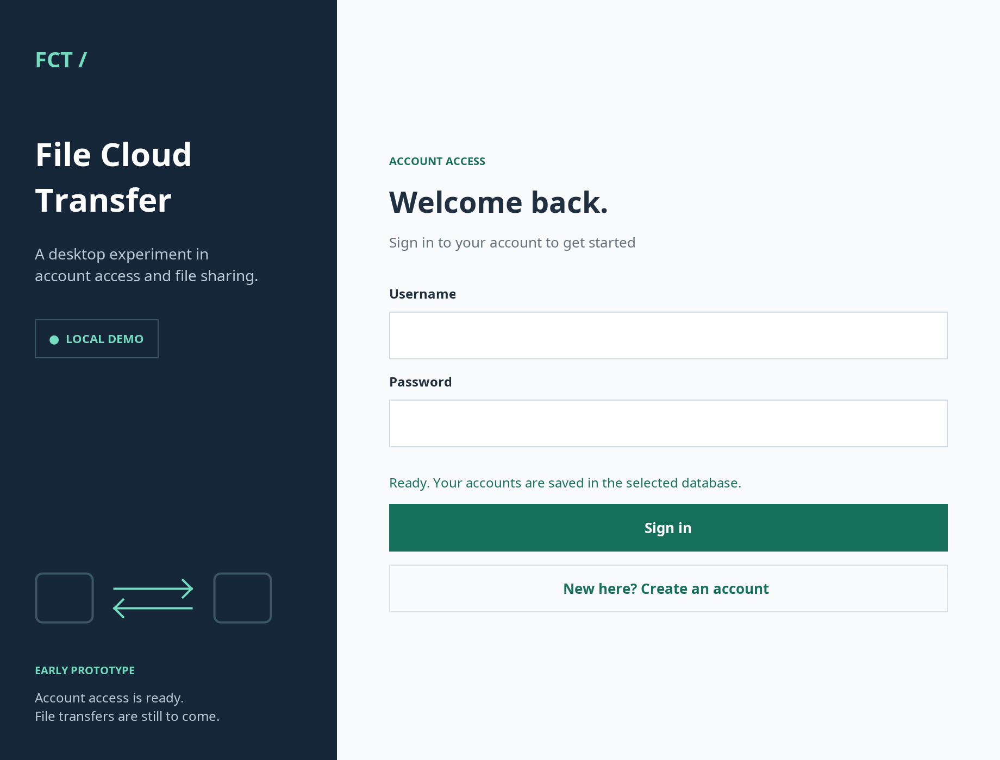
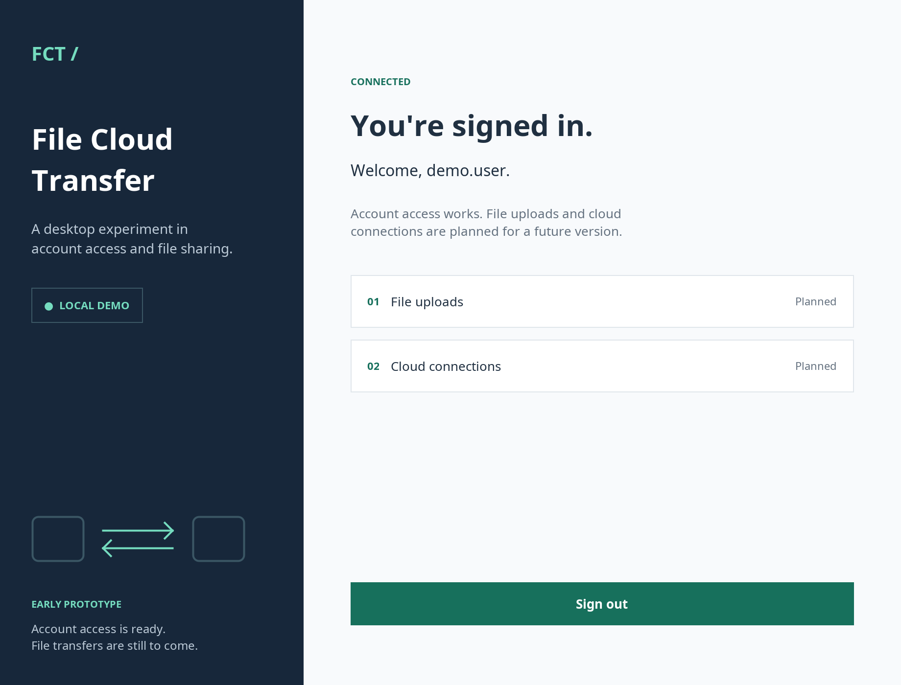

# File Cloud Transfer

[](https://github.com/gc292/FileCloudTransfer/actions/workflows/ci.yml)


A small Java desktop project exploring the account access layer of a future file transfer app. Built with Swing and JDBC, with a local database so you can try it without setting up a server.

**Current scope:** registration, login and a signed-in screen. File uploads, downloads and cloud storage connections are not implemented yet.



## Try it locally

You'll need a **JDK 17 or newer**, a desktop environment and an internet connection for the first build. Maven is included through the wrapper.

```bash
git clone https://github.com/gc292/FileCloudTransfer.git
cd FileCloudTransfer
./mvnw clean verify
java -jar target/file-cloud-transfer.jar
```

On Windows, use `mvnw.cmd clean verify` instead of `./mvnw clean verify`.

1. Select **New here? Create an account**.
2. Pick a username with 3–32 letters, numbers, dots, underscores or hyphens, and a password with 10–128 characters.
3. Confirm the password, create the account and sign in.
4. Try signing out and back in. Accounts persist between launches.

The default H2 database is created automatically in `data/`, relative to the folder you launch the app from. There are no preset accounts. Use a throwaway password while exploring this prototype.

<details>
<summary>After signing in</summary>



</details>

## What works

- Registration with password confirmation, input validation and duplicate username handling.
- Login, visible success/error messages and sign-out.
- Persistent local accounts with no database server to install.
- Optional MySQL connection through environment variables.
- Salted PBKDF2-HMAC-SHA256 password hashes with 600,000 iterations. The format stores the algorithm, work factor, salt and hash together. See the [OWASP password storage guidance](https://cheatsheetseries.owasp.org/cheatsheets/Password_Storage_Cheat_Sheet.html).
- Database and password hashing work runs off the Swing event thread, keeping the window responsive.

## Optional: MySQL

The default [embedded H2 database](https://h2database.com/html/quickstart.html) is enough for a local demo. To use MySQL instead, create an empty database and a dedicated user with permission to create and use its tables, then set:

```bash
export FCT_DB_URL='jdbc:mysql://localhost:3306/filecloudtransfer'
export FCT_DB_USER='fct'
export FCT_DB_PASSWORD='your-local-database-password'
java -jar target/file-cloud-transfer.jar
```

| Variable | Default |
| --- | --- |
| `FCT_DB_URL` | `jdbc:h2:file:./data/filecloudtransfer` |
| `FCT_DB_USER` | `sa` |
| `FCT_DB_PASSWORD` | Empty, for the embedded local demo |

The app creates its `fct_users` table on startup. Environment variables are read from the process; `.env` files are not loaded automatically. Database credentials and local data are excluded from Git.

The original experiment used a `passwords.users` table and SHA-256 hashes. This version uses a separate table and password format; old accounts are not migrated or modified.

## Development

```bash
./mvnw verify
```

The tests use temporary H2 databases and run without a graphical display. They cover account persistence, duplicate users, invalid input, password verification, the registration/login/sign-out UI flow and database connection errors. GitHub Actions runs the build on Java 17 and 21 and attaches a runnable JAR to each successful run.

```text
src/main/java/LoginApp/
  Main.java           Desktop entry point
  GUI.java            Swing views and background tasks
  AuthService.java    Registration, validation and login
  DBConfig.java       Environment-based JDBC configuration
  PasswordUtils.java  Password hashing and verification
src/test/java/LoginApp/
docs/                 Screenshots rendered from the actual Swing views
```

To refresh the screenshots after changing the UI:

```bash
./mvnw -Dtest=GUITest -Dfct.previewDir=docs test
```

If Maven reports an unsupported Java release, check that `JAVA_HOME` points to a **JDK 17+**, rather than a JRE or an older JDK. If the app reports it needs a desktop, launch the JAR in a graphical session; tests can still run on a headless machine.

## Next steps

- [x] Make the account prototype easy to run and test.
- [ ] Add local file selection and a transfer history view.
- [ ] Implement one storage provider before adding more.
- [ ] Add transfer progress, cancellation and retries.

This is a learning project, not a production authentication or file storage service. It has no password recovery, login rate limiting or cloud integration. The local database is not encrypted at rest.
